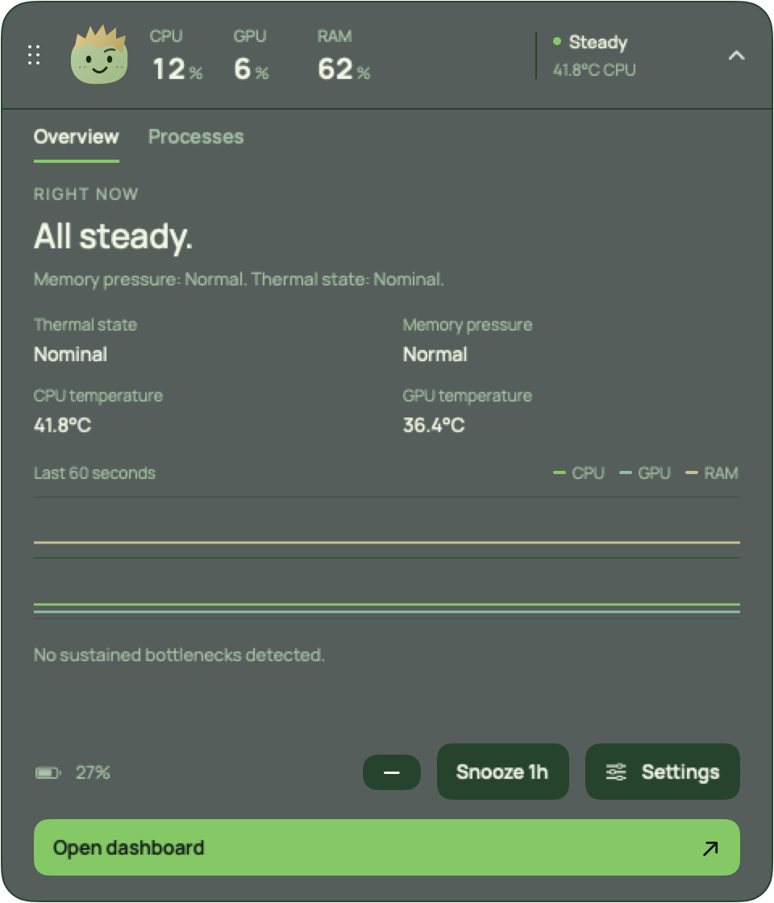
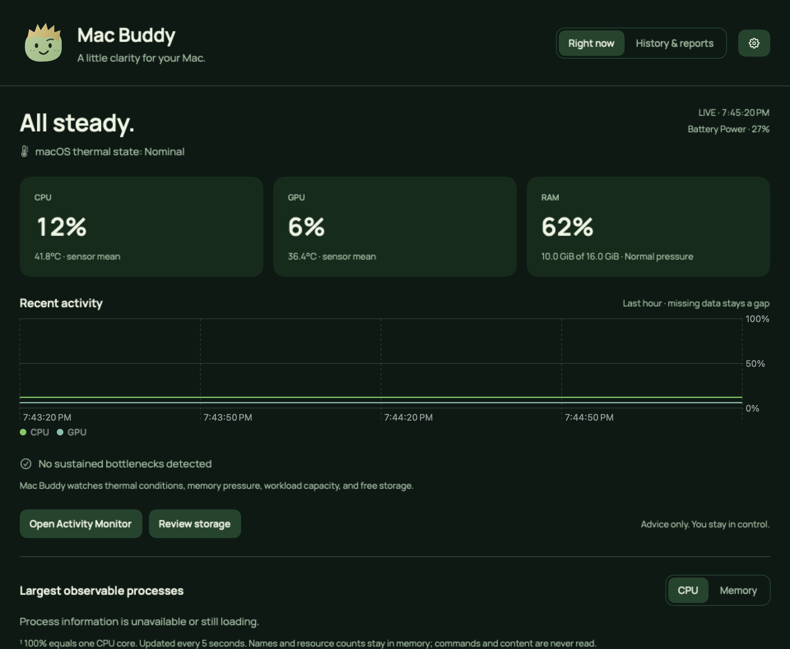

# Mac Buddy

[](https://github.com/harshsahrawat-commits/MacBuddy/actions/workflows/ci.yml)

A quiet, local-only companion for your Mac. Native CPU, GPU and RAM monitoring, a movable floating display, contextual advisories, local history and PDF reports—with Pebble keeping you company.

**M4-focused source beta.** Validated on one M4 MacBook Air. This repository contains source code, not a notarized app download. Build it on your own Mac using the instructions below. Broader hardware and OS validation is still needed.


<details>
<summary>Expanded panel and dashboard</summary>





</details>

*Actual native view rendered with synthetic readings; not a live hardware benchmark.*

## What it does

- **Monitoring:** overall CPU/GPU utilization, CPU/GPU sensor means when available, memory estimate and pressure, compression, swap usage/activity, storage, battery and macOS thermal state.
- **Floating companion:** horizontal metric strip, automatic vertical docking at side edges, or a draggable Pebble-only avatar. CPU/GPU/RAM remain visible in the strip and expanded panel. Hover Pebble for a warm, contextual response.
- **Expanded panel:** live overview, a gap-aware 60-second CPU/GPU/RAM chart, observable processes sorted by CPU or memory, battery details, alert snooze and routes to the dashboard and Settings.
- **Dashboard:** current metrics, recent activity, sustained advisories, process information, and History & reports.
- **Local history:** one hour of samples in memory, 30 days of minute summaries, then daily archives. Missing observations remain gaps. PDF reports use UTC day boundaries.
- **Controls:** customizable global shortcut, display modes, 60–100% background opacity, saved placement, drag lock, keyboard position nudges, sampling modes, optional silent notifications and launch at login.
- **Accessibility:** native keyboard controls and labels, Reduce Motion support, and solid backgrounds with Reduce Transparency or increased contrast. Spoken VoiceOver acceptance is still pending.

Mac Buddy offers advice and links to Activity Monitor and Storage Settings. It does **not** quit processes, change system settings, read your screen or infer what you are working on. There is no AI service or cloud backend.

## Compatibility

| Hardware / OS | Status |
| --- | --- |
| M4 MacBook Air, macOS 27.0.1 | Physical device used for development and recorded validation. Remaining checks are listed in [validation](docs/VALIDATION.md). |
| Other M4 MacBooks, including Pro/Max | Unverified. Sensor presence and mappings can differ. |
| M1/M2/M3 and other Apple-silicon Macs | Outside the initial supported beta. General monitoring may work; temperatures deliberately report unavailable outside M4, and GPU readings depend on the adapter. |
| Intel Macs | Unsupported by the ARM64 build script. A separate build and telemetry validation are required. |
| macOS 14+ | Declared deployment target, not a claim that every version has been physically tested. CI build coverage is documented separately. |

Temperature and GPU utilization rely on isolated, undocumented, read-only adapters. An OS update may make them unavailable. Missing readings are displayed honestly rather than converted to zero. See [architecture and limitations](docs/ARCHITECTURE.md).

## Build and launch

You need an Apple-silicon Mac, macOS 14 or newer, and **Swift 6 or newer** through Xcode or Apple's Command Line Tools. An older installed toolchain may need updating. Git and the compiler are included with the tools; no Homebrew packages, Swift package downloads, API keys or paid Apple Developer membership are required for a local build.

If the tools are not installed, run this once and finish Apple's installer:

```sh
xcode-select --install
```

Then check your toolchain and build:

```sh
swift --version
git clone https://github.com/harshsahrawat-commits/MacBuddy.git
cd MacBuddy
./scripts/build.sh
open "dist/Mac Buddy.app"
```

Alternatively choose **Code → Download ZIP**, extract it, open Terminal in the extracted folder and run the last two commands. The build creates an ARM64 bundle signed locally with an ad-hoc signature. It does not install or launch it automatically.

The app lives in the **menu bar**, with no regular Dock icon. The first launch opens the dashboard. On a display without a built-in notch, use the menu-bar menu → **Center on this screen** to place the floating display.

You may copy `dist/Mac Buddy.app` to `~/Applications` for a stable location; quit the previous copy first and launch the copy you intend to keep. Enable launch at login only after choosing that location. Avoid running multiple copies, which share the same settings and history.

This local build is not a signed distribution package. Sharing the built `.app` with someone else is not equivalent to them building it locally; downloaded copies can be blocked by Gatekeeper. Do not disable Gatekeeper. A Developer ID signed, notarized download is a [later milestone](docs/DISTRIBUTION.md).

## Controls

| Action | Control |
| --- | --- |
| Show/hide floating display | **Control–Option–Command–M** by default; change its physical letter key/modifiers in Settings. |
| Expand/collapse | Click the strip or Pebble; use the panel's collapse control. The minus button minimizes to Pebble. |
| Move | Drag the dotted handle in metric mode, or drag Pebble itself in avatar mode. Position is saved. |
| Dock vertically | With **Turn vertical at side edges** enabled, drop the metric strip within 32 points of a usable left/right edge. Drag away to return horizontal. |
| Choose shape | Settings → Appearance → **Floating display**, menu-bar submenu, or floating-display context menu. |
| Placement | Settings → Placement or context menu: Return to notch, Center on this screen, Lock dragging; Settings also provides 20-point arrow nudges. |
| Transparency | Settings → Appearance → Background opacity. Text stays opaque; macOS accessibility settings can force a solid background. |
| Visibility | Always visible, Shortcut only, or Off. Monitoring and history continue when the floating display is hidden. |
| Notifications | Off by default; enable silent advisories in Settings and grant macOS permission. Snooze for one hour or resume early. |
| Launch at login | Off by default; opt in under Settings → Monitoring. macOS may require approval in Login Items. |
| Stop monitoring | Menu bar → **Quit Mac Buddy**. Closing a window alone leaves the app running. |

A disconnected display falls back to an available screen while retaining the saved display preference. There is one saved placement, not a separate placement per monitor. Fullscreen/Spaces behavior depends on macOS; uninterrupted three-finger swipe animation remains unverified.

## Understanding the readings

Overall CPU is normalized across all cores. Process CPU uses the Activity Monitor convention: **100% equals one core**. Process visibility is limited by OS permissions and a bounded snapshot; this is not a complete process inspector.

RAM is a labelled Mach VM estimate, which can differ from Activity Monitor's accounting. System memory pressure is an independent signal. Swap-out activity is a rate, separate from allocated swap. Disk availability uses capacity available for important usage and can include reclaimable space.

Thermal wording follows macOS thermal state. Celsius readings are informational; there are no invented internal-temperature danger bands. Advisories use Mac Buddy heuristics for sustained load, thermal conditions, pressure and low storage, with recovery tracking and per-category cooldowns. They are not Apple-certified safety limits.

## Privacy and local data

Mac Buddy has no analytics, accounts, network requests or remote storage. It reads system counters and transient process names/PIDs; it does not read command-line arguments, browser content, documents, prompts, keyboard input or screen pixels. No Screen Recording or Accessibility permission is required. Notifications and login startup are optional. See [privacy](docs/PRIVACY.md) for storage, diagnostics and backup details.

- History: `~/Library/Application Support/MacBuddy/history.sqlite` plus SQLite sidecars.
- Preferences: macOS UserDefaults domain `app.macbuddy.personal` (normally `~/Library/Preferences/app.macbuddy.personal.plist`). This identifier is retained for continuity with existing installs.
- Reports: saved only to the location you choose.

The archive has a **100 MiB budget including sidecars**. If maintenance cannot create headroom, recording pauses with an explanation; it does not silently erase old history. Retry or explicitly clear history in Settings.

To uninstall, turn off launch at login in Mac Buddy, quit it, and remove your app copy. Data stays available for a future install. To erase it too, clear history in Settings before quitting, then remove `~/Library/Application Support/MacBuddy`; optionally run `defaults delete app.macbuddy.personal` to remove preferences. Delete any exported PDFs separately. Removing data is irreversible—back it up first if you want to keep it.

## Development and project status

```sh
./scripts/check.sh
./scripts/scheduler-check.sh
"dist/Mac Buddy.app/Contents/MacOS/MacBuddy" --runtime-checks
```

`MacBuddyChecks` is a standalone executable runner; **`swift test` is not the test entry point**. The scheduler/runtime checks use disposable history. See [contributing](CONTRIBUTING.md), [validation](docs/VALIDATION.md), [known issues](docs/KNOWN_ISSUES.md) and [architecture](docs/ARCHITECTURE.md).

A previous 30-minute normal-app run recorded **49.26 MiB mean / 107.39 MiB sampled peak** memory. That transient remains unexplained. A separate stability run was deliberately stopped at **4h 59m 26s**, so there is no completed eight-hour pass. These measurements predate the latest UI; they are not performance certification for this source beta. Lifetime peaks and profiling overhead have different scopes.

## License

Mac Buddy is [MIT licensed](LICENSE). Keep the [third-party notices](THIRD_PARTY_NOTICES.md); the bundled Manrope font retains its separate [SIL Open Font License](Resources/Fonts/OFL.txt).
